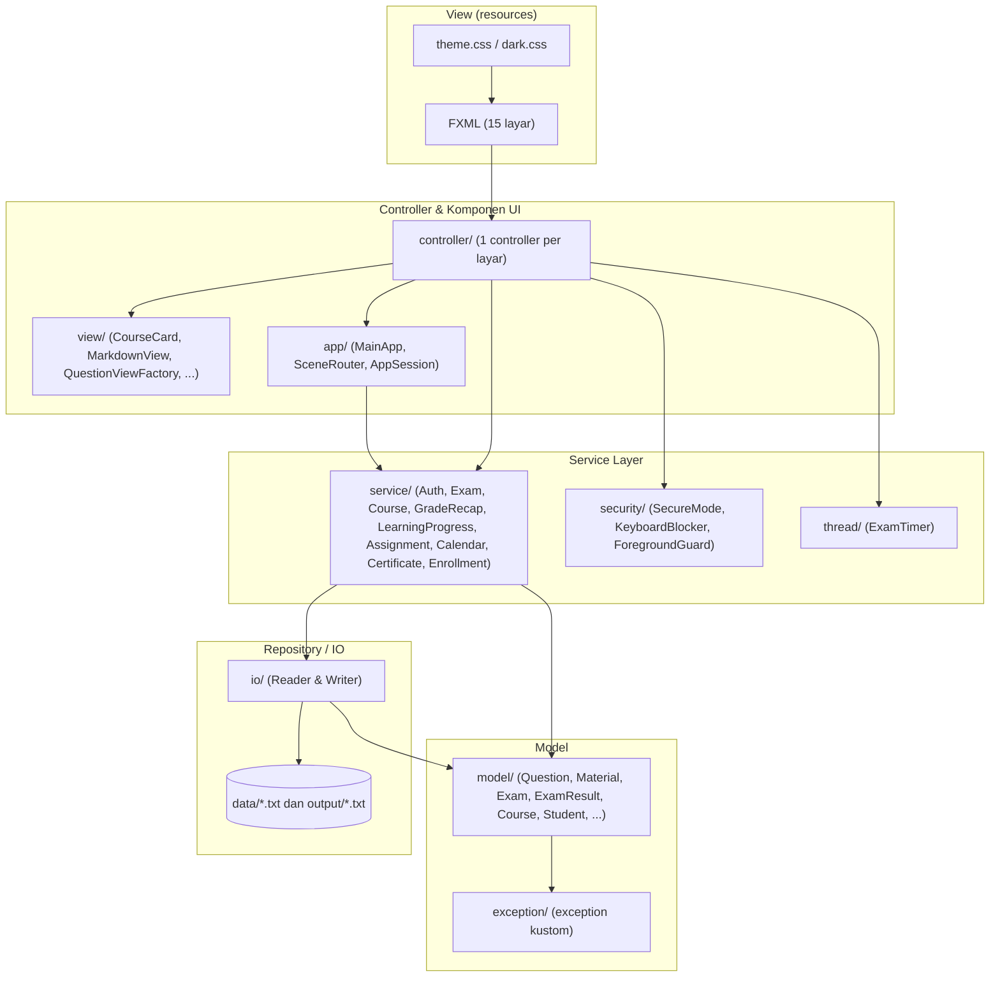
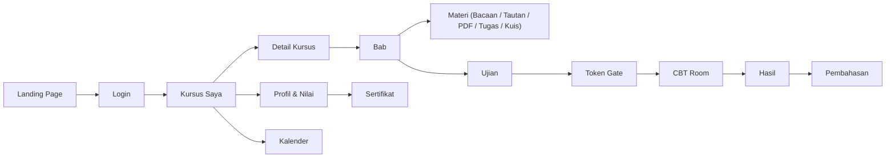

<div align="center">


# Examify

### Kelompok 8

Aplikasi desktop **E-Learning & Computer-Based Test (CBT)** berbasis JavaFX: belajar per kursus dan bab,
mengerjakan ujian dengan token dan timer, lalu melihat nilai dan mengunduh e-sertifikat. Semua data
disimpan di file teks UTF-8, tanpa database.

<br>


</div>

---

## Daftar Isi

1. [Deskripsi Project](#1-deskripsi-project)
2. [Arsitektur Project](#2-arsitektur-project)
3. [Struktur Project](#3-struktur-project)
4. [Instalasi & Menjalankan](#4-instalasi--menjalankan)
5. [Panduan Penggunaan](#5-panduan-penggunaan)
6. [Detail Teknis](#6-detail-teknis)
   - [Class & Object](#61-class--object)
   - [Java Variables](#62-java-variables)
   - [Inheritance](#63-inheritance)
   - [Encapsulation](#64-encapsulation)
   - [Polymorphism](#65-polymorphism)
   - [Abstraction](#66-abstraction)
   - [String](#67-string)
   - [Generic & Collections](#68-generic--collections)
   - [Exception & Assertions](#69-exception--assertions)
   - [Java IO](#610-java-io)
   - [Java GUI](#611-java-gui)
   - [Multithreading](#612-multithreading)
7. [Anggota Kelompok](#7-anggota-kelompok)

---

## 1. Deskripsi Project

**Examify** adalah aplikasi desktop yang menggabungkan **Learning Management System (LMS)** dan
**Computer-Based Test (CBT)** dalam satu aplikasi. Examify dibuat sebagai tugas besar mata kuliah
Pemrograman Berorientasi Objek untuk menerapkan konsep OOP dan Java Core dalam aplikasi yang
benar-benar bisa dipakai.

Ada dua peran pengguna:

| Peran     | Login dengan | Yang bisa dilakukan |
|-----------|--------------|---------------------|
| **Siswa** | NIS + PIN    | Mendaftar kursus (dari katalog atau lewat kode), membaca materi, mengerjakan kuis/ujian/tugas, melihat progres, nilai, pembahasan, kalender, dan mengunduh sertifikat |
| **Guru**  | NIP + PIN    | Mengelola kursus, bab, dan materi (editor materi berbasis slide), membuat dan mengubah bank soal, mengatur token, durasi, KKM, waktu akses, dan Mode Aman, memantau nilai siswa |

### Fitur Utama

| Kategori | Fitur |
|----------|-------|
| **Landing page** | Statistik aplikasi, katalog kursus, pencarian kursus, dan profil anggota kelompok sebelum login |
| **E-Learning** | Hierarki *Kursus → Bab → Materi*. Ada 6 jenis materi: Bacaan (Markdown), Tautan web, PDF, Kuis, Ujian, dan Tugas (dengan tenggat dan unggah file) |
| **Progres belajar** | Status selesai per materi disimpan permanen, ditampilkan sebagai persentase per kursus |
| **CBT** | Token ujian (dikunci 60 detik setelah 3 kali salah), soal diacak, timer di thread terpisah, tandai soal ragu-ragu, navigasi nomor soal, dan *auto-submit* saat waktu habis |
| **Jenis soal** | Pilihan Ganda (PG, opsi A–E), Benar/Salah (TF), dan Isian Singkat (IS, boleh lebih dari satu kunci) |
| **Mode Aman** | Layar penuh terkunci, blokir Alt+Tab, tombol Windows, Alt+F4, Print Screen (hook keyboard native via JNA), blokir salin/tempel, dan pencatatan pelanggaran |
| **Hasil & nilai** | Skor 0–100 berbobot, predikat A–E, lulus/tidak berdasarkan KKM, pembahasan soal, riwayat ujian, dan grafik nilai terbaik |
| **E-Sertifikat** | Sertifikat teks dengan kode unik `EXF-...` untuk ujian yang lulus |
| **Kalender** | Agenda ujian, kuis, dan tenggat tugas dalam tampilan bulan/minggu/daftar |
| **Panel guru** | Bank soal, editor ujian, editor materi (undo/redo, blok teks/kode/kutipan/callout), daftar siswa beserta detail nilainya |
| **Tampilan** | Tema terang/gelap, efek *glassmorphism*, animasi halus, font Poppins |

### Data Contoh

- **5 siswa** (`data/siswa.txt`), **7 guru** (`data/guru.txt`), **23 kursus** (`data/kursus.txt`)
  dengan materi Markdown di `data/materi/`, serta bank soal UTS/UAS untuk setiap kursus (`data/bank_soal.txt`).

---

## 2. Arsitektur Project

Examify memakai pola **MVC + Service Layer + Repository (I/O)**. Setiap lapisan hanya bergantung pada
lapisan di bawahnya, sehingga model dan service bisa diuji dengan JUnit tanpa menjalankan JavaFX.



### Alur Aplikasi



### Tanggung Jawab Lapisan

| Lapisan | Package | Tanggung jawab |
|---------|---------|----------------|
| Entry point | `app` | `Launcher` → `MainApp` (memuat data di `init()`, membangun service), `SceneRouter` (navigasi & tema), `AppSession` (singleton penyimpan state login dan service) |
| Controller | `controller` | Menangani event UI dari FXML dan memanggil service |
| View | `view` | Komponen UI buatan sendiri yang dipakai ulang (kartu, ikon, latar animasi, date-time picker, Markdown renderer) |
| Service | `service` | Logika bisnis: login, verifikasi token, penilaian, rekap nilai, progres, pendaftaran, tugas, kalender, sertifikat |
| Model | `model` | Entitas domain, `record`, `enum`, dan `interface` (bebas dari JavaFX) |
| Repository | `io` | Membaca dan menulis file teks dengan validasi format per baris |
| Thread | `thread` | Timer ujian di thread terpisah |
| Security | `security` | Mode Aman berbasis Windows API (JNA) |
| Exception | `exception` | Checked exception kustom |
| Utils | `utils` | Konstanta (`AppConfig`), helper String, format, parser Markdown |

---

## 3. Struktur Project

```
examify/
├── pom.xml                          konfigurasi Maven (Java 21, JavaFX, JNA, JUnit)
├── mvnw, mvnw.cmd, .mvn/            Maven Wrapper (Maven 3.10.0)
├── LICENSE
├── data/                            data input (dibaca & ditulis saat runtime)
│   ├── siswa.txt                    NIS|NAMA|KELAS|PIN
│   ├── guru.txt                     data guru
│   ├── kursus.txt                   kursus, bab, dan materi
│   ├── bank_soal.txt                ujian & soal
│   ├── tim.txt                      anggota kelompok (landing page)
│   └── materi/<kursus>/*.md         bacaan Markdown per kursus
├── output/                          data hasil (dibuat otomatis)
│   ├── rekap_nilai.txt              riwayat nilai
│   ├── progres_belajar.txt          materi yang sudah selesai
│   ├── pendaftaran_kursus.txt       kursus yang diikuti siswa
│   ├── pelanggaran_ujian.txt        log pelanggaran Mode Aman
│   └── sertifikat/                  e-sertifikat
└── src/
    ├── main/
    │   ├── java/
    │   │   ├── module-info.java     modul com.examify
    │   │   └── com/examify/
    │   │       ├── app/             Launcher, MainApp, SceneRouter, AppScreen, AppSession
    │   │       ├── controller/      Landing, Login, Shell, MyCourses, CourseDetail, TokenGate,
    │   │       │                    CbtRoom, Result, ExamReview, Profile, Calendar,
    │   │       │                    QuestionBank, ExamEditor, MaterialEditor,
    │   │       │                    TeacherStudents, TeacherStudentDetail, + util dialog/tabel/tema
    │   │       ├── exception/       DataFormatException, QuestionBankFormatException,
    │   │       │                    InvalidTokenException, EmptyAnswerException, TimeOutException
    │   │       ├── io/              DataReader<T>, LineReader<T>, LineWriter<T>, Student/Teacher/
    │   │       │                    Team/Course/QuestionBank/GradeRecap/LearningProgress Reader,
    │   │       │                    Course/QuestionBank/GradeRecap/LearningProgress/Violation/
    │   │       │                    Certificate Writer, QuestionBankParser, SlideMarkdownConverter
    │   │       ├── model/           Question (+ MultipleChoice, TrueFalse, ShortAnswer),
    │   │       │                    Material (+ Text, Link, Pdf, Exam, Quiz, Assignment),
    │   │       │                    Exam, ExamResult, Course, Chapter, Student, Teacher,
    │   │       │                    TeamMember, Gradable, GradeHistory, ProgressRecord,
    │   │       │                    CalendarAgenda, enum (QuestionType, MaterialType, ...),
    │   │       │                    material/ (SlideDraft, BlockDraft, BlockType)
    │   │       ├── security/        SecureMode, KeyboardBlocker, ForegroundGuard
    │   │       ├── service/         Auth, Exam, Course, CourseEnrollment, LearningProgress,
    │   │       │                    GradeRecap, Assignment, Calendar, Certificate
    │   │       ├── thread/          ExamTimer (Runnable), TimerListener
    │   │       ├── utils/           AppConfig, StringUtil, FormatUtil, MarkdownParser, HtmlMarkdownUtil
    │   │       └── view/            AnimatedBackground, AnimationUtil, CourseCard, MemberCard,
    │   │                            CoursePattern, DateTimePicker, Icon, IconView, MarkdownView,
    │   │                            QuestionViewFactory, SmoothScroll, CenteredGrid
    │   └── resources/com/examify/
    │       ├── fxml/                16 file tampilan (landing, login, shell, kursus_saya, ...)
    │       ├── css/                 theme.css (terang) & dark.css (gelap)
    │       ├── font/                Poppins (SIL Open Font License)
    │       └── img/                 examifylogo.png
    └── test/java/com/examify/       unit test JUnit (app, controller, io, model, service, thread, utils)
```

> [!NOTE]
> `data/` dan `output/` sengaja berada di luar `src/` karena dibaca dan ditulis saat aplikasi berjalan,
> bukan bagian dari kode sumber.

---

## 4. Instalasi & Menjalankan

### Kebutuhan

| Kebutuhan | Keterangan |
|-----------|------------|
| **JDK 21+** | Wajib (`maven.compiler.release = 21`). Cek dengan `java -version` |
| **Maven** | Tidak perlu dipasang: Maven Wrapper (`mvnw`/`mvnw.cmd`) mengunduh Maven 3.10.0, JavaFX, dan dependensi lain secara otomatis |
| **OS** | Windows, macOS, atau Linux. Mode Aman (hook keyboard) hanya berfungsi penuh di **Windows** |
| **Internet** | Hanya saat build pertama (mengunduh dependensi) |

### Langkah Instalasi

```bash
# 1. Clone repository
git clone <url-repository> examify
cd examify

# 2. Jalankan aplikasi
./mvnw javafx:run          # Git Bash / macOS / Linux
mvnw.cmd javafx:run        # Command Prompt / PowerShell
```

> [!IMPORTANT]
> Jalankan dari **folder root project**, karena path `data/` dan `output/` relatif terhadap working directory.

### Perintah Maven Lainnya

| Perintah | Fungsi |
|----------|--------|
| `./mvnw compile` | Kompilasi kode |
| `./mvnw test` | Menjalankan seluruh unit test JUnit |
| `./mvnw package` | Membuat `target/examify-1.0.0.jar` |
| `./mvnw clean` | Menghapus hasil build (`target/`) |

### Menjalankan dari VS Code

Pasang **Extension Pack for Java**. VS Code otomatis membaca `pom.xml` dan mengunduh JavaFX. Jalankan
`com.examify.app.Launcher` lewat menu *Run and Debug*. Tambahkan VM argument `-ea` agar assertion aktif.

> [!TIP]
> Ingin mengulang dari awal? Hapus folder `output/`. Riwayat nilai, progres belajar, pendaftaran, dan
> sertifikat akan dibuat ulang saat aplikasi dipakai.

---

## 5. Panduan Penggunaan

### Akun Contoh

**Siswa** (`data/siswa.txt`):

| NIS     | PIN  | Nama          | Kelas |
|---------|------|---------------|-------|
| 2410001 | 1234 | Andi Pratama  | IF-A  |
| 2410002 | 5678 | Budi Santoso  | IF-B  |
| 2410003 | 2468 | Citra Lestari | IF-C  |
| 2410004 | 1111 | Dimas Saputra | IF-D  |
| 2410005 | 6767 | Eka Rahmawati | IF-E  |

**Guru** (`data/guru.txt`): NIP `19850101` s.d. `19850107`, semua dengan PIN `1234`.

### Token Ujian Contoh

| Kursus                          | Ujian          | Token  | Durasi | Boleh ulang | Mode Aman |
|---------------------------------|----------------|--------|--------|-------------|-----------|
| Pemrograman Berorientasi Objek  | PBO-01 (UTS)   | PBOUT7 | 60 mnt | tidak       | tidak     |
| Pemrograman Berorientasi Objek  | PBO-02 (UAS)   | PBOUA7 | 90 mnt | tidak       | tidak     |
| Konsep Pemrograman              | KP-01 (UTS)    | KPUT21 | 60 mnt | tidak       | tidak     |
| Basis Data                      | BDAT-01 (UTS)  | BDAUT8 | 60 mnt | tidak       | tidak     |
| Kelas Uji Coba (kode `UJI`)     | UJI-01         | UJI123 | 1 mnt  | ya          | ya        |

Token lainnya ada di `data/bank_soal.txt` atau menu **Bank Soal** (akun guru). Kode kursus berupa angka
(contoh: Pemrograman Berorientasi Objek = `0953123017`) dan bisa dipakai di tombol **Masuk lewat Kode**.

### Sebagai Siswa

1. **Landing page** → klik **Masuk**, isi NIS dan PIN.
2. **Kursus Saya** → pilih kursus yang diikuti, atau daftar kursus baru dari katalog / **Masuk lewat Kode**.
3. **Detail Kursus** → pilih bab di panel kiri, lalu buka materi:
   - *Bacaan*: dibaca langsung di aplikasi (Markdown), tandai **selesai** untuk menambah progres.
   - *Tautan / PDF*: dibuka di browser atau aplikasi PDF bawaan.
   - *Tugas*: unggah file sebelum tenggat, beri catatan opsional.
   - *Kuis / Ujian*: lanjut ke langkah 4.
4. **Token Gate** → masukkan token. Salah 3 kali = dikunci 60 detik.
5. **CBT Room** → kerjakan soal; jawaban tersimpan otomatis. Gunakan navigasi nomor soal dan tombol
   **Tandai** untuk soal ragu-ragu. Timer menjadi merah dan berdenyut pada 60 detik terakhir. Klik
   **Kumpulkan**, atau jawaban dikumpulkan otomatis saat waktu habis.
6. **Hasil** → lihat skor, predikat, jumlah benar/salah/kosong, dan status lulus. Buka **Pembahasan**
   untuk melihat kunci jawaban.
7. **Profil** → rata-rata nilai, grafik nilai terbaik per mapel, riwayat ujian, dan unduh **e-sertifikat**.
8. **Kalender** → lihat jadwal ujian, kuis, dan tenggat tugas.

### Sebagai Guru

1. Login dengan NIP dan PIN.
2. **Kursus Saya** → buat kursus baru atau buka kursus yang diampu, lalu tambah/ubah bab dan materi.
3. **Editor Materi** → susun bacaan berbasis slide (heading, paragraf, kode, kutipan, callout) dengan undo/redo;
   hasilnya disimpan sebagai Markdown.
4. **Bank Soal / Editor Ujian** → buat ujian, atur token, durasi, KKM, waktu akses, boleh ulang, dan Mode Aman,
   lalu tambah soal PG/TF/IS beserta bobotnya.
5. **Siswa** → pantau nilai seluruh siswa, filter per kelas, dan lihat detail riwayat setiap siswa.

### Mode Aman (`STRICTLY_SAFE=true`)

- Jendela tidak bisa ditutup, diminimalkan, atau keluar dari layar penuh.
- Alt+Tab, tombol Windows, Ctrl/Alt+Esc, Ctrl+Shift+Esc, Alt+F4, dan Print Screen diblokir.
- Salin, potong, tempel, menu klik kanan, dan seret-lepas dimatikan.
- Setiap kali meninggalkan jendela ujian, muncul peringatan dan kejadiannya dicatat di `output/pelanggaran_ujian.txt`.
- Mode Aman berakhir otomatis saat jawaban dikumpulkan atau waktu habis. (Ctrl+Alt+Del tetap tidak bisa diblokir oleh aplikasi biasa.)

### Format File Data

<details>
<summary><b>data/bank_soal.txt</b></summary>

```
[UJIAN]
KODE=PBO-01
MAPEL=Pemrograman Berorientasi Objek
TOKEN=PBOUT7
DURASI=60
KKM=70
ULANG=false          # opsional: true = boleh dikerjakan ulang
STRICTLY_SAFE=false  # opsional: true = Mode Aman
[SOAL]
PG|id|pertanyaan|opsi1;opsi2;...;opsiN|kunci(A-E)|bobot
TF|id|pernyataan|kunci(T/F)|bobot
IS|id|pertanyaan|jawaban1;jawaban2;...|bobot
[END]
```
</details>

<details>
<summary><b>data/kursus.txt</b></summary>

```
[KURSUS]
KODE=PBO
NAMA=Pemrograman Berorientasi Objek
PENGAJAR=Dr. Rina Kartika, M.Kom.
DESKRIPSI=Konsep OOP dan Java Core.
[BAB] Class & Object
TEKS|pbo-02|Class, Object, dan Konstruktor|materi/pbo/02-class-object.md
LINK|pbo-02b|Oracle Tutorial: Classes|https://docs.oracle.com/javase/tutorial/java/javaOO/classes.html
PDF|pbo-07b|Ringkasan Empat Pilar OOP|materi/pbo/ringkasan-pilar-oop.pdf
UJIAN|pbo-uts|Ujian Tengah Semester|PBO-01
[END]
```

Path `TEKS` dan `PDF` relatif terhadap folder `data/`.
</details>

<details>
<summary><b>File lainnya</b></summary>

- `data/siswa.txt`: `NIS|NAMA|KELAS|PIN`
- `data/tim.txt`: `NIM|NAMA|FOTO|WEBSITE|GITHUB|INSTAGRAM|LINKEDIN`
- Baris kosong dan baris berawalan `#` diabaikan. Karakter `|` dan `;` tidak boleh dipakai di dalam teks.
  Bila file rusak, aplikasi menampilkan nomor baris dan isi baris yang salah.
</details>

---

## 6. Detail Teknis

Bagian ini memetakan setiap materi PBO ke implementasinya di kode Examify.

### 6.1 Class & Object

| Implementasi | Lokasi | Penjelasan |
|--------------|--------|------------|
| Class entitas domain | `model/Student`, `Teacher`, `Course`, `Chapter`, `Exam`, `ExamResult`, `TeamMember` | Setiap konsep bisnis dimodelkan sebagai class dengan atribut dan perilaku sendiri |
| Constructor dengan validasi | `Question(...)`, `Student(...)`, `Material(...)` | Objek ditolak (`IllegalArgumentException`) bila data tidak valid, sehingga objek selalu konsisten |
| Constructor overloading & chaining | `ExamResult(Student, Exam)` → `this(siswa, ujian, Clock.systemDefaultZone())`; `ExamTimer`, `ExamService`, `DataFormatException` | Constructor pendek memanggil constructor lengkap dengan nilai bawaan |
| Pembuatan objek | `MainApp.init()` | `new StudentReader()`, `new ExamService(...)`, `new CourseService(...)`, dll. membangun seluruh objek aplikasi |
| Singleton | `AppSession` (`private static final AppSession INSTANCE`, `getInstance()`) | Satu objek sesi berbagi state login dan service ke semua controller |
| Static factory method | `GradeHistory.dari(ExamResult)`, `QuestionType.dariKode(...)`, `MaterialType.dariKode(...)` | Membuat/mencari objek tanpa constructor langsung |
| `record` | `GradeHistory`, `ProgressRecord`, `CalendarAgenda`, `SecureMode.Pelanggaran`, `ViolationWriter.Catatan` | Class data immutable yang ringkas |
| `enum` dengan field & constructor | `QuestionType(kode, jumlahField, label)`, `MaterialType(label)`, `ExamStatus`, `AnswerStatus`, `SubmitMode`, `AppScreen` | Konstanta bertipe aman yang membawa data |
| Override method `Object` | `Student.equals/hashCode/toString` (berdasarkan NIS), `Question.toString`, `Material.toString` | Objek aman dipakai sebagai key `HashMap` dan mudah di-debug |
| Inner/nested class | `ProfileController.SelStatus`, `SelPembahasan`, `TableUtil.SelBisaDibuka<T>`, `record DrafSnapshot` | Class pembantu yang hanya dipakai di dalam class induk |

### 6.2 Java Variables

| Jenis variabel | Contoh di kode | Lokasi |
|----------------|----------------|--------|
| **Instance variable** | `private final String nis, nama, kelas, pin;` | `Student` |
| **Instance variable mutable** | `private double skor; private int jumlahBenar; private ExamStatus status = ExamStatus.BERLANGSUNG;` | `ExamResult` |
| **Static variable (class variable)** | `private static final AppSession INSTANCE = new AppSession();` | `AppSession` |
| **Konstanta (`static final`)** | `NAMA_APLIKASI = "Examify"`, `MAKS_PERCOBAAN_TOKEN = 3`, `JEDA_RESET_TOKEN_DETIK = 60`, `GRACE_PERIOD_DETIK = 2` | `AppConfig` |
| **Konstanta interface** (implisit `public static final`) | `double NILAI_MAKSIMUM = 100.0;` | `Gradable` |
| **Local variable** | `String jawaban = normalisasi(inputJawaban);`, `int gagal = percobaanGagal.merge(...)` | `MultipleChoiceQuestion`, `ExamService` |
| **Local variable inference (`var`)** | `var rekapService = new GradeRecapService(...)` | `MainApp.init()` |
| **Parameter** | `evaluasiJawaban(String inputJawaban)`, `simpanJawaban(int idSoal, String jwb)` | `Question`, `ExamResult` |
| **`final` variable** | Hampir semua field model (`private final List<String> opsi;`) | `model/*` |
| **`volatile` variable** | `private volatile int sisaWaktu; private volatile boolean berjalan = true;` | `ExamTimer`, `KeyboardBlocker`, `ForegroundGuard` |
| **Pattern variable** | `if (!(o instanceof Student lain))`, `if (materi instanceof TextMaterial mt)` | `Student`, `CourseDetailController` |
| **Effectively-final variable di lambda** | `int snapshot = sisaWaktu; uiExecutor.execute(() -> listener.onTick(snapshot));` | `ExamTimer.run()` |
| **Tipe primitif** | `byte MIN_OPSI = 2` dan `MAKS_OPSI = 5`, `short DURASI_MAKS_MENIT = 180`, `char kunciJawaban`, `int`, `long deadlineNanos`, `double bobot`, `boolean` | `MultipleChoiceQuestion`, `Exam`, `ExamTimer`, `Question` |
| **Tipe referensi / wrapper** | `Map<String, Integer> percobaanGagal`, `Set<Integer> soalDitandai` | `ExamService`, `ExamResult` |
| **Array** | `private static final String[] FONT = {"Regular","Medium","SemiBold","Bold"};`, `String[] field = DataLine.pecahField(baris)` | `MainApp`, `LineReader` |
| **`serialVersionUID`** | `private static final long serialVersionUID = 1L;` | semua class di `exception/` |

### 6.3 Inheritance

| Superclass / Interface | Subclass | Keterangan |
|------------------------|----------|------------|
| `Question` *(abstract)* | `MultipleChoiceQuestion`, `TrueFalseQuestion`, `ShortAnswerQuestion` | Mewarisi `idSoal`, `pertanyaan`, `bobot`, `jenis`; memanggil `super(idSoal, pertanyaan, bobot, QuestionType.PG)` |
| `Material` *(abstract)* | `TextMaterial`, `LinkMaterial`, `PdfMaterial`, `ExamMaterial`, `QuizMaterial`, `AssignmentMaterial` | Mewarisi `idMateri`, `judul`, `jenis` |
| `LineReader<T>` *(abstract)* | `GradeRecapReader`, `LearningProgressReader` | Template method: subclass cukup menentukan `getJumlahField()` dan `dariField()` |
| `LineWriter<T>` *(abstract)* | `GradeRecapWriter`, `LearningProgressWriter`, `ViolationWriter` | Subclass menentukan `getHeader()` dan `keBaris()` |
| `Exception` | `DataFormatException`, `InvalidTokenException`, `EmptyAnswerException`, `TimeOutException` | Checked exception kustom |
| `DataFormatException` | `QuestionBankFormatException` | Inheritance bertingkat (*multilevel*): `Exception` → `DataFormatException` → `QuestionBankFormatException` |
| `javafx.application.Application` | `MainApp` | Override `init()` dan `start()` |
| `javafx.scene.control.TableCell` | `SelStatus`, `SelPembahasan`, `SelSertifikat`, `SelHasil`, `SelBisaDibuka<T>` | Sel tabel kustom |
| `Pane` / `VBox` / `StackPane` | `AnimatedBackground extends Pane`, `CourseCard`/`MemberCard`/`DateTimePicker extends VBox`, `IconView extends StackPane` | Komponen UI kustom yang dapat dipakai di FXML |

### 6.4 Encapsulation

| Implementasi | Lokasi | Penjelasan |
|--------------|--------|------------|
| Field `private` + getter | Semua class di `model/` | Data hanya bisa diakses lewat method publik |
| Data sensitif tanpa getter | `Student.pin`, `Teacher.pin` → hanya `verifikasiPin(String)` | PIN tidak pernah keluar dari objek |
| Kunci jawaban tersembunyi | `MultipleChoiceQuestion.kunciJawaban` (komentar: *"encapsulated: tanpa getter"*); `bukaKunci(ExamStatus)` melempar `IllegalStateException` bila ujian belum `SELESAI` | Kunci hanya bisa dibuka setelah ujian selesai |
| Immutable object | Field `final`, `List.copyOf(opsi)`, `Collectors.toUnmodifiableSet()`, `record` | State tidak bisa diubah dari luar setelah objek dibuat |
| State dijaga lewat method | `ExamResult.simpanJawaban()` menolak jawaban bila status bukan `BERLANGSUNG` atau lewat batas waktu; `setDitandai()` hanya bekerja saat ujian berlangsung | Perubahan state selalu melewati aturan bisnis |
| Access modifier bertingkat | `protected Question(...)`, `protected String normalisasi(...)`, package-private `parseBaris(...)` di reader (untuk unit test) | Visibilitas seminimal mungkin |
| Constructor `private` | `AppConfig`, `StringUtil`, `QuestionViewFactory`, `AppSession` | Mencegah instansiasi class utilitas/singleton |
| Modul Java | `module-info.java`: hanya `exports com.examify.app` dan `opens controller/view` ke JavaFX | Enkapsulasi di tingkat package |

### 6.5 Polymorphism

| Jenis | Implementasi | Lokasi |
|-------|--------------|--------|
| **Runtime (overriding / dynamic dispatch)** | `soal.evaluasiJawaban(jwb)` dipanggil lewat referensi `Question`; PG membandingkan huruf, TF menerima alias (`T/TRUE/B/BENAR`), IS mencocokkan beberapa kunci tanpa tanda baca | `ExamResult.nilaiJawaban(Question)` |
| Override method abstract | `getPetunjukFormat()`, `bukaKunci()` di setiap jenis soal; `getKeterangan()` di setiap jenis materi | `model/*Question`, `model/*Material` |
| Polimorfisme interface | `DataReader<T>`: `StudentReader`, `TeacherReader`, `CourseReader`, `QuestionBankReader`, `TeamReader` dipakai seragam oleh `MainApp.muat(DataReader<T>, Path)` | `MainApp` |
| Interface callback | `TimerListener` diimplementasikan `CbtRoomController` (`onTick`, `onWaktuHabis`) | `CbtRoomController` |
| Default method | `Gradable.getPredikat()` memakai `hitungNilaiAkhir()` milik class pengimplementasi | `Gradable`, `ExamResult` |
| `Comparable` | `ExamResult.compareTo` dan `GradeHistory.compareTo` (skor tertinggi dulu) | `ProfileController` memakai `.sorted()` |
| **Compile-time (overloading)** | Constructor `ExamResult(...)`, `ExamTimer(...)`, `ExamService(...)` (2 s.d. 5 parameter) | `model`, `thread`, `service` |
| Pattern matching `instanceof` & `switch` | `if (soal instanceof MultipleChoiceQuestion pg)`, `switch (materi) { ... }` | `QuestionViewFactory`, `CourseDetailController`, `CourseWriter` |
| Upcasting | `List<Question> daftarSoal` berisi PG/TF/IS; `List<Material>` berisi 6 jenis materi | `Exam`, `Chapter` |

### 6.6 Abstraction

| Implementasi | Lokasi | Penjelasan |
|--------------|--------|------------|
| Abstract class | `Question` | Method abstract `evaluasiJawaban`, `getPetunjukFormat`, `bukaKunci`; method konkret `normalisasi`, `pastikanSelesai` |
| Abstract class | `Material` | Method abstract `getKeterangan()` |
| Abstract generic class | `LineReader<T>`, `LineWriter<T>` | Alur baca/tulis file sudah jadi; detail format diserahkan ke subclass (*Template Method Pattern*) |
| Interface | `Gradable` | Kontrak `hitungNilaiAkhir()` + konstanta `NILAI_MAKSIMUM` + default `getPredikat()` |
| Interface generic | `DataReader<T>` | Kontrak `List<T> baca(Path)` untuk semua pembaca file |
| Interface callback | `TimerListener` | Timer tidak perlu tahu siapa yang menampilkan waktu |
| Service layer | `service/*` | Controller cukup memanggil `ujianService.verifikasiToken(...)` tanpa tahu detail penyimpanan |
| Abstraksi waktu | `java.time.Clock` dan `java.util.concurrent.Executor` disuntikkan ke `ExamResult`, `ExamService`, `ExamTimer` | Logika waktu bisa diuji dengan `ControlledClock` tanpa menunggu waktu nyata |

### 6.7 String

| Implementasi | Contoh | Lokasi |
|--------------|--------|--------|
| Normalisasi | `teks.trim().replaceAll("\\s+", " ").toUpperCase()` | `StringUtil.normalisasi` |
| Validasi kosong | `teks == null \|\| teks.isBlank()` | `StringUtil.isKosong` |
| Format & padding | `String.format("%-" + lebar + "s", ...)`, `" ".repeat(kiri)`, `substring` | `StringUtil.kiri/tengah` (sertifikat) |
| Regex | `TANDA_BACA_AKHIR = "[.,;!?]+$"` membuang tanda baca di akhir jawaban isian | `ShortAnswerQuestion` |
| Split | Memecah baris `a\|b\|c` dan sub-nilai `x;y;z` | `DataLine.pecahField`, `pecahSubNilai` |
| Perbandingan | `equalsIgnoreCase` (kode enum, token, opsi), `equals` (PIN, NIS) | `QuestionType`, `Exam`, `Student` |
| `char` & `Character` | `(char) ('A' + indeks)`, `Character.toUpperCase(kunci)`, `charAt(0)` | `MultipleChoiceQuestion` |
| `StringBuilder` | Membangun token acak, isi sertifikat, Markdown dari slide | `QuestionBankController`, `CbtRoomController`, `SlideMarkdownConverter` |
| Format pesan | `String.format("Baris %d tidak valid -> %s%n    isi: \"%s\"", ...)` | `DataFormatException` |
| Parsing Markdown | Heading, list, kode, kutipan, **tebal**, *miring*, `kode` | `MarkdownParser`, `HtmlMarkdownUtil` |
| Konversi | `String.valueOf(char)`, `Integer.parseInt`, `Double.parseDouble` (dengan `NumberFormatException`) | `QuestionBankParser` |

### 6.8 Generic & Collections

**Generic**

| Implementasi | Lokasi |
|--------------|--------|
| Generic interface `DataReader<T>` | `io/DataReader` |
| Generic abstract class `LineReader<T>`, `LineWriter<T>` | `io/` |
| Generic method `private static <T> List<T> muat(DataReader<T> reader, Path file)` | `MainApp` |
| Generic inner class `SelBisaDibuka<T> extends TableCell<T, String>` | `TableUtil` |
| Parameterized type: `Comparable<ExamResult>`, `Optional<Student>`, `Consumer<String>`, `TableCell<GradeHistory, String>` | `model`, `service`, `view` |

**Collections**

| Koleksi | Penggunaan | Lokasi |
|---------|-----------|--------|
| `ArrayList` | Hasil baca file | `LineReader`, `TeamReader` |
| `List.of` / `List.copyOf` | List immutable (opsi soal, katalog ujian) | `MultipleChoiceQuestion`, `ExamService` |
| `LinkedHashMap` | Jawaban siswa `Map<Integer, String>` (urutan terjaga), katalog `Map<String, Exam>`, `siswaByNis`, `guruByNip` | `ExamResult`, `ExamService`, `AuthService` |
| `HashMap` | `percobaanGagal`, `terkunciSampai`, header ujian | `ExamService`, `QuestionBankReader` |
| `TreeMap` | Nilai terbaik per mapel (urut abjad) untuk grafik | `ProfileController` |
| `HashSet` | Deteksi kode/NIS/ID duplikat | `CourseReader`, `StudentReader`, `Exam` |
| `LinkedHashSet` | Soal yang ditandai ragu-ragu | `ExamResult` |
| `Set.of` | Alias jawaban benar/salah | `TrueFalseQuestion` |
| `ArrayDeque` (sebagai `Deque`) | Stack undo/redo editor materi | `MaterialEditorController` |
| `Collections.newSetFromMap(new IdentityHashMap<>())` | Set baris tabel yang dibuka | `TableUtil` |
| `Optional` | Hasil pencarian yang mungkin kosong (`login`, `cariUjian`, `getNilaiTerbaik`) | `AuthService`, `ExamService`, `GradeRecapService` |
| Stream API | `filter`, `map`, `flatMap`, `distinct`, `sorted`, `mapToDouble().average()`, `allMatch`, `anyMatch`, `toList()` | `Course`, `ExamService`, `ProfileController`, dll. |
| `Map.merge` | `percobaanGagal.merge(kunci, 1, Integer::sum)` | `ExamService.verifikasiToken` |

### 6.9 Exception & Assertions

**Exception kustom (checked)**

| Exception | Superclass | Dilempar saat | Ditangani di |
|-----------|-----------|---------------|--------------|
| `DataFormatException` | `Exception` | Baris file data tidak sesuai format; menyimpan `nomorBaris` & `isiBaris` | `MainApp` (dialog error saat startup) |
| `QuestionBankFormatException` | `DataFormatException` | Format `bank_soal.txt` salah | `QuestionBankReader` → `MainApp` |
| `InvalidTokenException` | `Exception` | Token salah atau sedang dikunci; menyimpan `sisaPercobaan` | `TokenGateController` |
| `EmptyAnswerException` | `Exception` | Menyimpan jawaban kosong | `CbtRoomController` |
| `TimeOutException` | `Exception` | Menjawab/submit manual setelah batas waktu; menyimpan `kodeUjian` | `CbtRoomController` (beralih ke `selesaikanPaksa`) |

**Teknik penanganan exception**

| Teknik | Contoh | Lokasi |
|--------|--------|--------|
| `throws` pada deklarasi | `List<T> baca(Path) throws IOException, DataFormatException` | `DataReader` |
| `try-with-resources` | `try (BufferedReader br = Files.newBufferedReader(...))` | semua reader/writer |
| Exception chaining | `catch (RuntimeException e) { throw new DataFormatException(noBaris, baris, e.getMessage(), e); }` | `LineReader.parseBaris` |
| Multi-catch | `catch (IllegalArgumentException \| IOException ex)` | `MyCoursesController` |
| Unchecked untuk validasi | `IllegalArgumentException` (data tidak valid), `IllegalStateException` (kunci dibuka sebelum selesai, timer dimulai 2×) | `Question`, `ExamTimer` |
| Penanganan `InterruptedException` | `Thread.currentThread().interrupt(); return;` | `ExamTimer.run` |
| Error startup ditunda | Exception di `init()` disimpan lalu ditampilkan di `start()` (FX Application Thread) | `MainApp` |

**Assertions** (aktif dengan VM flag `-ea`)

| Assertion | Lokasi |
|-----------|--------|
| `assert sisaWaktu >= 0;` | `ExamTimer.run()` |
| `assert skor >= 0 && skor <= NILAI_MAKSIMUM : "Skor di luar rentang: " + skor;` | `ExamResult` (perhitungan nilai) |
| Status assertion dicetak saat startup: `MainApp.class.desiredAssertionStatus()` | `MainApp.init()` |

### 6.10 Java IO

Seluruh data disimpan dalam file teks UTF-8 memakai `java.nio.file` (`Files`, `Path`) dan `java.io`
(`BufferedReader`, `BufferedWriter`).

| Operasi | Class | File | Teknik |
|---------|-------|------|--------|
| Baca siswa / guru / tim | `StudentReader`, `TeacherReader`, `TeamReader` | `siswa.txt`, `guru.txt`, `tim.txt` | `Files.newBufferedReader(path, UTF_8)` + `readLine()` per baris |
| Baca kursus | `CourseReader` | `kursus.txt` + `materi/**/*.md` | Parser blok `[KURSUS]…[BAB]…[END]`, cek file materi ada |
| Baca bank soal | `QuestionBankReader` + `QuestionBankParser` | `bank_soal.txt` | State machine `enum Posisi { LUAR_BLOK, HEADER, SOAL }` |
| Baca log | `GradeRecapReader`, `LearningProgressReader` | `rekap_nilai.txt`, `progres_belajar.txt` | `LineReader<T>`: file belum ada dianggap kosong |
| Tulis log (append) | `GradeRecapWriter`, `LearningProgressWriter`, `ViolationWriter` | `output/*.txt` | `StandardOpenOption.CREATE, APPEND`; header ditulis sekali; method `synchronized` |
| Tulis ulang data | `CourseWriter`, `QuestionBankWriter` | `kursus.txt`, `bank_soal.txt` | Menyimpan perubahan dari editor guru |
| Tulis sertifikat | `CertificateWriter` | `output/sertifikat/*.txt` | Teks berformat lebar tetap |
| Salin file tugas | `AssignmentService` | `data/pengumpulan_tugas/` | `Files.copy` file unggahan siswa |
| Konversi slide ↔ Markdown | `SlideMarkdownConverter` | `materi/*.md` | Parsing dan serialisasi teks |
| Baca resource | `MainApp.muatFont()` | `font/Poppins-*.ttf` | `getResourceAsStream` dalam try-with-resources |
| Persiapan folder | `AppConfig.siapkanFolderOutput()` | `output/`, `sertifikat/` | `Files.createDirectories` |

### 6.11 Java GUI

GUI dibangun dengan **JavaFX** (`javafx.controls`, `javafx.fxml`, `javafx.web`).

| Aspek | Implementasi |
|-------|--------------|
| Application lifecycle | `MainApp extends Application` → `init()` memuat data, `start(Stage)` menampilkan jendela; `Launcher` sebagai entry point |
| FXML + Controller | 16 layar FXML (`landing`, `login`, `shell`, `kursus_saya`, `kursus_detail`, `token_gate`, `cbt_room`, `result`, `pembahasan_ujian`, `profil`, `kalender`, `bank_soal`, `editor_ujian`, `editor_materi`, `guru_siswa`, `guru_detail_siswa`) dengan anotasi `@FXML` |
| Navigasi | `SceneRouter.pindah(AppScreen)` + `enum AppScreen`; `shell.fxml` sebagai kerangka (sidebar + konten) |
| Styling | `theme.css` (variabel warna di `.root`) dan `dark.css` (menimpa variabel untuk mode gelap); `ThemeUtil` untuk ganti tema |
| Glassmorphism | `AnimatedBackground` (gumpalan warna + `GaussianBlur`) di belakang kartu semi-transparan |
| Animasi | `AnimationUtil` (`FadeTransition`, `TranslateTransition`, `Timeline`): fade-in halaman, kartu muncul berurutan, hover terangkat, angka menghitung naik, getar saat PIN salah, timer berdenyut |
| Kontrol | `TableView` + `TableCell` kustom, `ToggleGroup`/`RadioButton` (PG/TF), `TextField` (isian), `ScrollPane`, `Dialog`, `Alert`, `BarChart` (grafik nilai di Profil) |
| Komponen kustom | `CourseCard`, `MemberCard`, `IconView`/`Icon` (ikon SVG), `DateTimePicker`, `MarkdownView`, `CenteredGrid`, `SmoothScroll`, `CoursePattern` |
| Factory UI | `QuestionViewFactory.buatInput(...)` membangun kontrol sesuai jenis soal sehingga model bebas dari JavaFX |
| WebView | Pratinjau editor materi (`javafx.web`) |
| Event handling | Lambda pada `setOnAction`, listener `textProperty()`/`selectedToggleProperty()`, filter keyboard |
| Font | Poppins (Regular, Medium, SemiBold, Bold) dimuat dengan `Font.loadFont` |

### 6.12 Multithreading

| Implementasi | Lokasi | Penjelasan |
|--------------|--------|------------|
| `Runnable` + `Thread` | `ExamTimer implements Runnable`; `new Thread(this, "Examify-Timer")` | Countdown ujian berjalan di thread terpisah dari FX Application Thread |
| Daemon thread | `thread.setDaemon(true)` | Thread tidak menahan JVM saat aplikasi ditutup |
| `Thread.sleep` & interrupt | `Thread.sleep(1000)`; `stop()` memanggil `thread.interrupt()` | Timer berhenti segera saat submit manual |
| `volatile` | `sisaWaktu`, `berjalan` (`ExamTimer`); `jalan`, `jendelaUjian` (`ForegroundGuard`); `hook`, `idThread` (`KeyboardBlocker`) | Perubahan terlihat antar-thread |
| `synchronized` | `ExamTimer.mulai/stop`, `LineWriter.tulis`, `ExamService.tambah/perbarui/hapusUjian`, `AssignmentService.*` | Mencegah race condition pada start/stop dan penulisan file |
| Komunikasi ke UI thread | `Platform.runLater(...)` lewat `Executor uiExecutor` | Thread latar tidak pernah menyentuh `Node` secara langsung |
| Anti-drift | Sisa waktu dihitung dari `deadlineNanos - System.nanoTime()` | Timer tetap akurat walau `sleep` meleset |
| Callback | `TimerListener.onTick(int)` & `onWaktuHabis()` → `CbtRoomController` memperbarui label dan auto-submit | |
| Thread Mode Aman | `KeyboardBlocker` (thread `Examify-ModeAman-Keyboard` memompa message loop hook Windows), `ForegroundGuard` (thread `Examify-ModeAman-JendelaDepan` memantau jendela aktif) | Berjalan paralel selama ujian Mode Aman |
| Testable | `ExamTimer(int, TimerListener, Executor)` dapat diuji tanpa toolkit JavaFX | `ExamTimerTest` |

---

## 7. Anggota Kelompok

<div align="center">

**Kelompok 8**

| No | NIM | Nama | GitHub |
|:--:|:---:|------|--------|
| 1 | L0125044 | Gilang Ridho Wicaksana | [@geel-sana](https://github.com/geel-sana) |
| 2 | L0125105 | Lazuardi Akbar Imani | [@Dezkrazzer](https://github.com/Dezkrazzer) |
| 3 | L0125125 | Alfian Naufal Rabbani | [@Alfiannr234](https://github.com/Alfiannr234) |

</div>

---

<div align="center">

Dibuat untuk tugas besar mata kuliah **Pemrograman Berorientasi Objek**.

</div>
